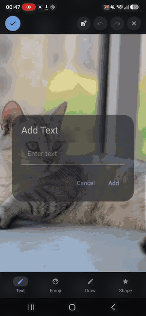
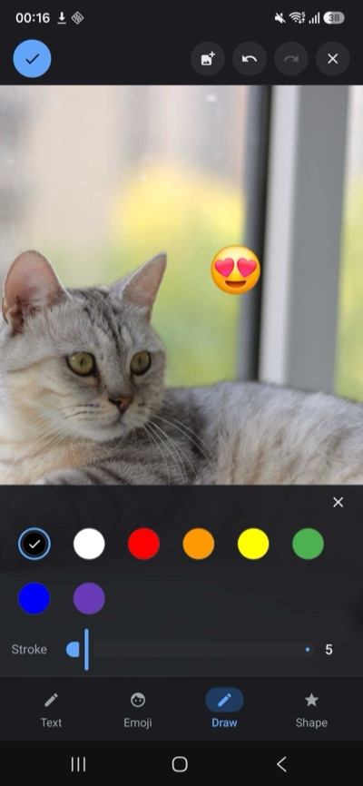
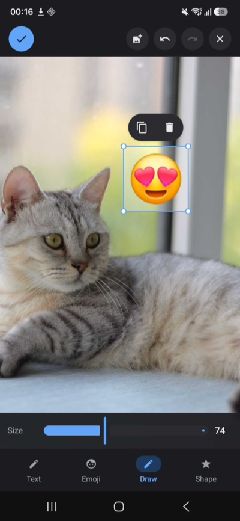
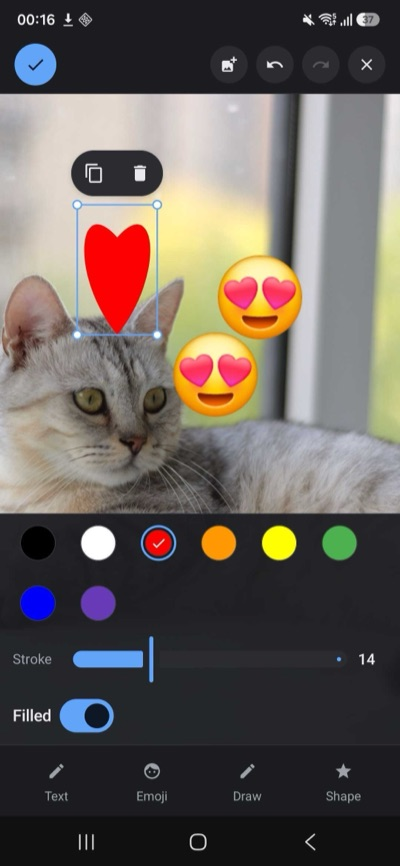
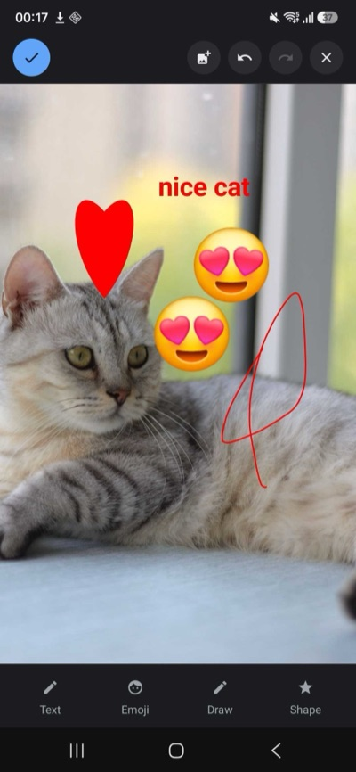

# photoEditor

[](https://jitpack.io/#Muzamilabdallah/photoEditor)

WhatsApp-style photo editor for Android, built with Jetpack Compose and published as **two independently installable artifacts**:

- **`photoeditor-core`** — the UI-agnostic engine: the editing canvas composable, element model, gestures, undo/redo, state holder, and export. Zero Material dependency, no opinion about how panels look.
- **`photoeditor-ui-default`** — the optional batteries-included UI: tool panels (Shape, Text, Draw, Emoji), bottom tool nav, top bar, and a token-based `PhotoEditorTheme`. Depends on core.

Users overlay text, emoji, freehand drawings, and shapes (rect / circle / line / triangle / star / heart / arrow) on an image and export the composite via MediaStore or to a file.

<p align="center">
  
</p>

| Draw | Selection | Shape | Result |
|:----:|:---------:|:-----:|:------:|
|  |  |  |  |

*The built-in UI (Mode B), as shipped by `photoeditor-ui-default`.*

## Installation

Add the JitPack repository to your `settings.gradle.kts`:

```kotlin
dependencyResolutionManagement {
    repositories {
        google()
        mavenCentral()
        maven("https://jitpack.io")
    }
}
```

Then pick one of two modes. The current release is **`0.1.1`** (see [jitpack.io/#Muzamilabdallah/photoEditor](https://jitpack.io/#Muzamilabdallah/photoEditor) for newer tags):

```kotlin
// Mode A — canvas only, you build your own toolbar UI
implementation("com.github.Muzamilabdallah.photoEditor:photoeditor-core:0.1.1")

// Mode B — canvas + built-in panels (Shape, Text, Draw, Emoji)
implementation("com.github.Muzamilabdallah.photoEditor:photoeditor-core:0.1.1")
implementation("com.github.Muzamilabdallah.photoEditor:photoeditor-ui-default:0.1.1")
```

> **Pre-1.0.** The public API is still settling, so breaking changes can land in
> any `0.x` minor bump. Pin an exact version rather than a range.

**Which mode?** Pick **Mode B** if you want a working editor in one composable — `PhotoEditor(...)` ships the panels, toolbar, and theming, and you can restyle it with a few `PhotoEditorTheme` tokens (see [THEMING.md](THEMING.md)). Pick **Mode A** when the editor must match your app's own design system exactly: you get `PhotoEditorCanvas` (the full gesture-handling editing surface) plus all state types (`PhotoEditorState`, `EditorShape`, `ShapeToolState`, `EditorColors`), and every pixel of chrome is yours. `ui-default` declares core as an `api` dependency, so in Mode B the single `photoeditor-ui-default` line would suffice — listing both just makes the coupling explicit.

### Try the demo app

```bash
git clone https://github.com/Muzamilabdallah/photoEditor.git
cd photoEditor
./gradlew :app:installDebug
```

Launch "Photo Editor" from the app drawer and pick one of three samples: **Default UI** (Mode B, as shipped), **Customized default UI** (Mode B with a custom emoji list, a pastel swatch palette, and colors bridged from the app's `MaterialTheme`), or **Custom UI** (Mode A, a hand-rolled toolbar over core alone).

## Mode B — the built-in editor

The library declares **no permissions**. None are needed on Android 10+ (MediaStore writes are permission-free); only if your app supports API 24–28 *and* uses gallery saves, declare `WRITE_EXTERNAL_STORAGE` with `maxSdkVersion="28"` in your own manifest and request it at runtime (the demo app's manifest shows the entry). The `PhotoEditor` composable owns its state, theme, and UI; **image sourcing is yours** — the library ships no photo picker. Pass a bitmap directly:

```kotlin
import com.muzamil.photoeditor.ui.PhotoEditor

setContent {
    PhotoEditor(bitmap = myBitmap) // must be a software bitmap — see decodeEditableBitmap below
}
```

…or provide `onPickImage` with your own picking flow (here, the system photo picker) and load the result into hoisted state:

```kotlin
val state = rememberPhotoEditorState()  // hoist to observe/drive the editor
val context = LocalContext.current
var pickedUri by rememberSaveable { mutableStateOf<Uri?>(null) }

val pickImage = rememberLauncherForActivityResult(
    ActivityResultContracts.PickVisualMedia()
) { uri -> if (uri != null) pickedUri = uri }

LaunchedEffect(pickedUri) {
    val uri = pickedUri ?: return@LaunchedEffect
    withContext(Dispatchers.IO) {
        decodeEditableBitmap(context.contentResolver, uri)
    }?.let(state::loadImage)
}

PhotoEditor(
    state = state,
    onPickImage = {
        pickImage.launch(PickVisualMediaRequest(ActivityResultContracts.PickVisualMedia.ImageOnly))
    },
    saveDestination =                     // where the save button writes:
        SaveDestination.Gallery("MyApp"), //   Pictures/MyApp via MediaStore, or…
        // SaveDestination.File(File(filesDir, "edits/out.jpg")) — app-private path
)
```

`decodeEditableBitmap` (in `com.muzamil.photoeditor.image`, part of core) produces a size-capped bitmap (≤4096px on its longest edge) — use it when loading from a uri so huge camera originals don't run out of memory. Any bitmap works with `loadImage`, hardware ones included (they're copied to software on load). Loading a *different* image clears the current edits and undo history; loading into an empty editor (e.g. after process-death restore) keeps the restored edits. Pass `keepEdits` to override.

`PhotoEditor` lays out its own top bar and bottom tool nav and consumes the matching window insets, so give it the whole window rather than nesting it in another `Scaffold`'s content slot. The editing surface is the band between those two bars — nothing can be drawn or dragged behind them — and the tool sheets float over the bottom of it without blocking the canvas, fading out of the way while a gesture is in flight.

Edits survive rotation and process death: `PhotoEditorState` ships a custom `Saver`. The bitmap itself is too large for saved state — persist the uri (as above, via `rememberSaveable`) and re-decode on restore.

## Mode A — bring your own UI

Skip `photoeditor-ui-default` entirely and use `PhotoEditorCanvas` — the editing surface alone. It renders the image and elements and handles all editing gestures (select, deselect, drag/rotate/scale, freehand drawing); everything else is driven through `PhotoEditorState` from your own controls:

```kotlin
import com.muzamil.photoeditor.canvas.PhotoEditorCanvas
import com.muzamil.photoeditor.domain.EditorShape
import com.muzamil.photoeditor.domain.EditorTool

val state = rememberPhotoEditorState()
val context = LocalContext.current

Column {
    PhotoEditorCanvas(state, Modifier.weight(1f))
    MyToolbar(
        onAddText = { state.addText("Hello") },
        onDraw = { state.selectTool(EditorTool.Drawing) },
        onShape = { state.addShape(EditorShape.Circle) },
        onShapeStyle = { state.updateShapeTool(color = EditorColors.Blue, filled = true) },
        onUndo = { state.undo() },       // observe state.canUndo / state.canRedo
        onDelete = { state.deleteSelectedElement() },
        onSave = { state.saveEditedImage(context) },
    )
}
```

The tool state types your UI binds to (`ShapeToolState`, `EditorShape`, `EditorColors`) live in core — the built-in `ShapeToolPanel` uses exactly the same ones. `EditorShapePaths` (also core) builds each shape as a `Path` so custom pickers can render matching icons.

**Give the canvas its own space.** The canvas shows the whole photo (fit, letterboxed) and keeps elements inside it. Lay your chrome out beside it (as with `weight(1f)` above) rather than overlaying it in a `Box`: an element dragged under an opaque toolbar drawn on top of the canvas is still on the photo, just invisible and impossible to grab again.

**Positions and sizes are relative to the photo, not the screen.** Element positions are fractions of the bitmap's width/height, and every size — text, emoji, shape box, stroke width — is a fraction of the bitmap's **shorter side** (`state.updateDrawingStyle(strokeWidthRatio = 0.01f)` is a stroke 1% of the shorter side thick). So an edit looks the same on any screen and in the exported file, and the same value looks the same on every photo. `renderEdits(bitmap, elements)` renders an edit without any UI — e.g. in a `Worker` or a test.

Two snapshot properties on `PhotoEditorState` are worth binding your chrome to:

- **`selectedElementBounds`** — the selected element's live on-canvas bounds (null when nothing is selected). Anchor a contextual toolbar to it; it tracks the element through drags and transforms.
- **`isInteracting`** — true for as long as a canvas gesture is in flight (a freehand stroke, or an element drag/rotate/scale). Fade your controls out while it is set so they never cover what the user is drawing. The built-in UI does exactly this.

Load images with `state.loadImage(bitmap)`; decode uris with `decodeEditableBitmap` first (on a background dispatcher).

See `app/src/main/java/com/muzamil/photoeditor/` for all three working samples: `DefaultUiSample.kt` and `CustomizedUiSample.kt` (Mode B) and `CustomUiSample.kt` (Mode A).

## Theming

The default UI is styled entirely by `PhotoEditorTheme` design tokens (`PhotoEditorColors`, `PhotoEditorShapes`) — override a handful of colors to rebrand it, or replace individual panels while keeping the rest. See [THEMING.md](THEMING.md).

## License

Apache License 2.0 — see [LICENSE](LICENSE).
